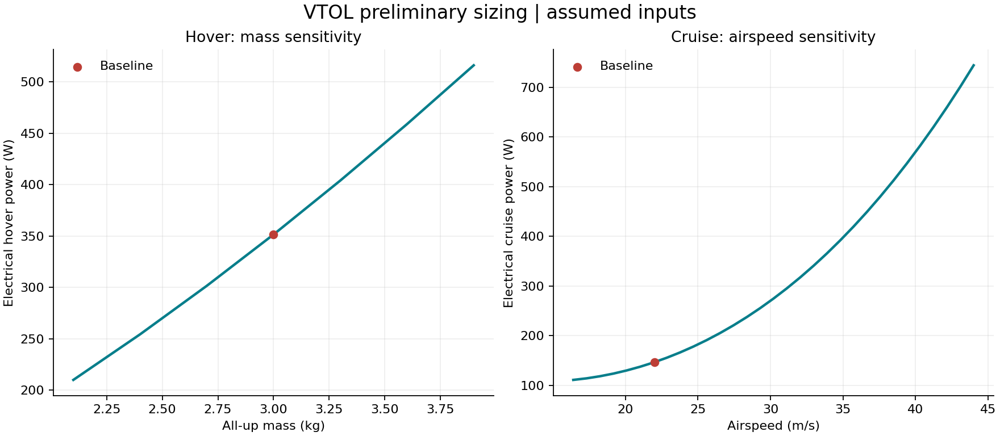
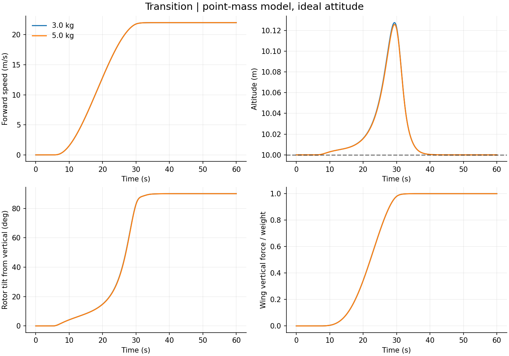
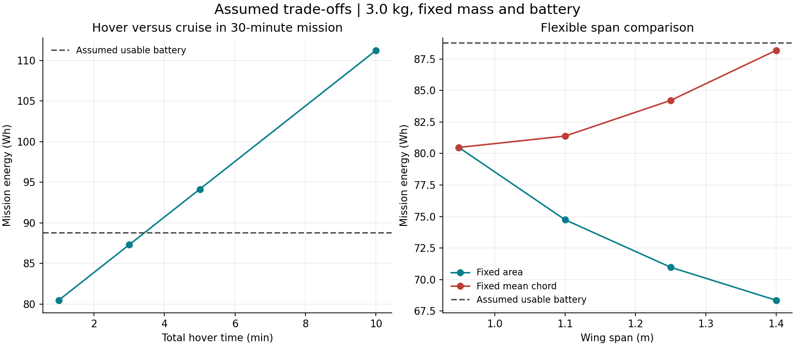

# Compact Search-and-Rescue VTOL Design Study


A second-year Mechanical Engineering project at the University of Exeter,
investigating a **four-tilting-rotor aircraft** for search-and-rescue observation
and basic aerial surveillance. The current deliverable is a design study with
educational hover and forward-transition simulations, suitable for discussing
engineering decisions in summer-placement interviews.

**Status: preliminary, assumption-based study.** No aircraft has been built or
flown, no components have been selected, and no model has been validated against
measurements. The sensor payload is still open. The simulation assumes ideal
attitude control; it is not a demonstrated aircraft controller.

For a quick review: [decision brief](reports/design-study/decision-brief.md),
[personal work](docs/personal-work.md), [evidence map](docs/evidence-map.md), and
[contributions](docs/contributions.md).

## Personal engineering work

The owner has supplied a [handwritten hover equation sheet and rough aircraft
sketch](docs/personal-work.md). The originals are preserved with a typed review,
units and clearly labelled AI-assisted numerical examples. The rear rotor pair
is intended to mount on the horizontal tail; all four rotors tilt forward for
cruise. The sketch is not dimensioned, and the equations have not yet been
supplemented by the owner's numerical substitutions or physical measurements.

## Design targets and first results

| Item | Confirmed target | Current study |
| --- | --- | --- |
| Architecture | Four forward-tilting rotors; rear pair on horizontal tail | Owner concept; simulation still an aggregate-force model |
| All-up mass | At most 5 kg | 3 kg candidate; 5 kg stress case |
| Wingspan | Around 1 m, flexible guide; wing only | 0.949 m starting candidate; larger span may be considered |
| Flight time | At least 30 minutes | Energy screen only, not demonstrated endurance |
| Parts budget | Around GBP 500, flexible | Student prototype scope; priced BOM pending |
| Payload | Observation sensor, not yet chosen | 0.15 kg mass allowance is an assumption |
| Fabrication | Basic 3D printer, soldering, household DIY tools | Mechanism and fabrication plan pending |

The 3 kg case estimates **80.5 Wh** for a 30-minute mission against **88.8 Wh** of
assumed usable energy. The 5 kg case needs **133.5 Wh** with the same battery and
wing. The nominal case has little headroom, and uncertain drag/efficiency inputs
can change the conclusion. The 5 kg limit is not a mass to design towards.



Read the [design study](reports/design-study/summary.md),
[individual sizing report](reports/sar/summary.md), and
[professional repository review](docs/repository-review.md) together.

## Run the study

Use Python 3.11 or 3.12 from the repository root:

```bash
python -m venv .venv
# Windows PowerShell:
.venv\Scripts\Activate.ps1
# macOS/Linux: source .venv/bin/activate
python -m pip install -r requirements.txt
python analysis/run_analysis.py --config data/sar_design.json --mass-budget data/sar_mass_budget.csv --output-dir reports/sar
python -m analysis.run_design_study
python -m analysis.run_layout_study
python -m simulation.run_simulation
python -m unittest discover -s tests -v
python tools/check_project.py
```

Code uses functions, dictionaries, loops, NumPy arrays, and documented equations.
SciPy supplies the established ODE solver rather than a handwritten integrator.
The sizing calculation also runs without third-party packages using `--no-plots`;
the numerical simulation needs the installed dependencies.

The [original tutorial](reports/example/summary.md) remains separate. Run
`python analysis/run_analysis.py` to regenerate it. Its 1.817 m wing was not
tailored to this project's approximately 1 m guide; a larger span needs a
documented design trade-off.

## Hover and forward transition



The [simulation results](reports/simulation/summary.md) illustrate rotor-to-wing
force sharing for 3 kg and 5 kg cases. Similar curves reflect ideal trim and
mass-scaled control forces, not equal real-world feasibility. Read the
[model derivation and limitations](simulation/README.md) before interpreting them.
The simulation does not calculate endurance, reverse transition, or landing.

## Start a review

- [Decision brief](reports/design-study/decision-brief.md): purpose, result, limits, next decision.
- [Evidence map](docs/evidence-map.md) and [contributions](docs/contributions.md):
  what exists, what is assumed, and what personal work is confirmed.
- [Personal work](docs/personal-work.md): original hand equations and sketch,
  review, units, and the next CG/load calculation.
- [Three-lens review](docs/three-lens-review.md): simulated recruitment, leadership,
  and senior-engineering views across Airbus, Rolls-Royce and BAE Systems.
- [Small design gates](docs/design-gates.md): finishable next steps.



The baseline assumes one minute total hover. Five minutes total hover within the
same 30-minute mission estimates 94.1 Wh, exceeding 88.8 Wh usable. Span comparisons
hold mass and coefficients fixed; they do not establish an optimal wing or include
structural/packaging consequences.

## Engineering evidence

The [provisional layout comparison](reports/layout-study/summary.md) examines
rotor tilt envelopes, mass stations and battery travel. It shortlists a widened
compact layout and a longer-front-support alternative for further analysis,
not manufacture. Read the [method and limitations](docs/layout-comparison.md).


1. [Project brief](docs/project-brief.md) and [requirements](docs/requirements.md).
2. [Architecture](docs/architecture.md) and [decision log](docs/decision-log.md).
3. [Sizing equations](docs/calculations.md) and [simulation model](simulation/README.md).
4. [Review and necessary additions](docs/repository-review.md).
5. [Verification](tests/README.md), [development log](docs/development-log.md), and
   [portfolio evidence](docs/portfolio.md).
6. [Original personal artifacts and review](docs/personal-work.md).

```text
analysis/              Sizing, target checks, and sensitivity studies
data/                  Confirmed brief, assumed candidate, and tutorial inputs
simulation/            Five-state point-mass hover/forward-transition model
reports/sar/           Candidate sizing outputs
reports/design-study/  Mass cases, sensitivity, and target screen
reports/layout-study/  Disc sweep, trial clearances, CG and battery-position cases
reports/simulation/    Simulation input snapshots, tables, and plots
reports/example/       Original tutorial outputs, not the compact aircraft
docs/                  Requirements, methods, review, decisions, and safety
hardware/              Component-selection and CAD evidence to develop
tests/ and tools/      Equation, input, solver, and reproducibility checks
```

## Next milestones

- [ ] Lay out all rotor discs and tilt envelopes; calculate centre of gravity.
- [ ] Calculate wing, horizontal-tail/boom and attachment loads, plus tilt torque;
      add CAD/drawings.
- [ ] Source compatible propulsion/battery data and a student-scale priced BOM.
- [ ] Select an observation payload and update mass, power, and cost allowances.
- [ ] Add attitude dynamics and geometry-based control authority to the model.
- [ ] Compare predictions with supervised, repeatable measurements.

See the [safety plan](docs/safety.md) and [staged test plan](docs/flight-test-plan.md).
Numerical results do not establish readiness for powered testing or flight.

## Authorship and reuse

The scaffold and this review/development pass were prepared with AI assistance.
The project owner supplied the mission, constraints, architecture, and educational
scope, plus the original hand equation sheet and rough sketch. Typed review,
numerical examples and added tests are AI-assisted, not unaided student work.
Record personal calculations, design revisions, measurements, and code
reviews in the development log. Claim only work and results you can explain and
support. No open-source licence has been selected yet.
