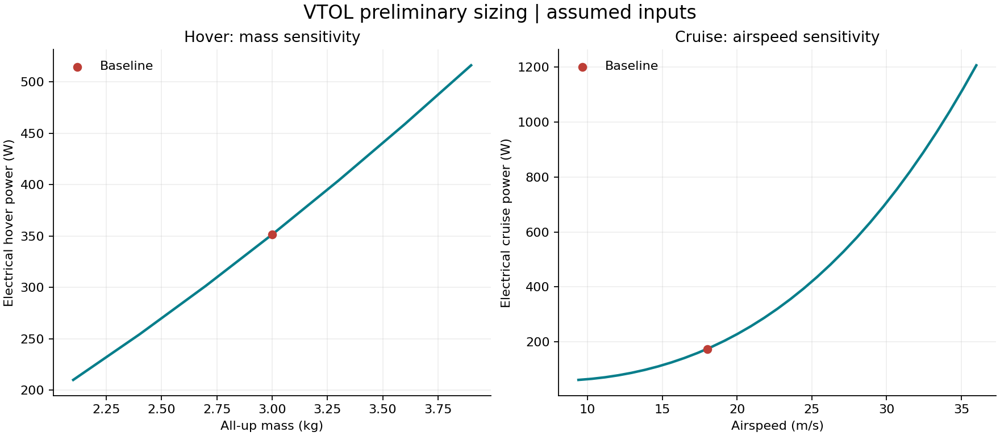

# VTOL Drone Project


A student engineering project exploring a small electric aircraft with vertical
take-off, wing-borne cruise, and vertical landing. The current study uses a
**provisional four-rotor tilt-rotor configuration**; tilt-wing remains an option
to compare before selecting an airframe.

**Status: preliminary design and analytical modelling.** This repository contains
a reproducible worked example, engineering documentation, and a validation plan.
It does not yet contain a built aircraft, measured propulsion data, flight logs,
or a demonstrated transition controller. All example inputs are assumptions.

## Project at a glance

| Item | Current scope |
| --- | --- |
| Engineering question | How do mass, rotor size, wing geometry, and mission time affect power and energy requirements? |
| Design direction | Tilt-rotor or tilt-wing; tilt-rotor is the calculation baseline only |
| Programming | Python functions, loops, dictionaries, CSV/JSON files, and unit tests |
| Methods | Force balance, actuator-disc hover model, lift/drag equations, and energy accounting |
| Evidence available | Reproducible example results and equation checks |
| Evidence still needed | Component measurements, structural and stability checks, and controlled test results |

## Run the worked example

Use Python 3.11 or newer. From the repository root:

```bash
python -m venv .venv
# Windows PowerShell:
.venv\Scripts\Activate.ps1
# macOS/Linux:
# source .venv/bin/activate
python -m pip install -r requirements.txt
python analysis/run_analysis.py
python -m unittest discover -s tests -v
python tools/check_project.py
```

The calculations and tests also run without installing any packages:

```bash
python analysis/run_analysis.py --no-plots
```

Edit [the example configuration](data/example_design.json) and
[the mass budget](data/example_mass_budget.csv) to explore your own assumptions.
Use `--config`, `--mass-budget`, and `--output-dir` to keep separate design cases.
The script saves a report, summary JSON, and CSV tables; Matplotlib adds the plot.

## Example results



The curves are analytical estimates using assumed inputs, not flight measurements.
Read the [generated results](reports/example/summary.md) alongside the
[equations and limitations](docs/calculations.md). The transition energy allowance
is a budgeting assumption; it does not model transition dynamics.

## Review the engineering work

1. [Project brief](docs/project-brief.md): problem, scope, and deliverables.
2. [Requirements](docs/requirements.md): proposed targets and verification methods.
3. [Architecture](docs/architecture.md) and [decision log](docs/decision-log.md):
   alternatives, trade-offs, and unresolved decisions.
4. [Calculations](docs/calculations.md): equations, units, sources, and assumptions.
5. [Results](reports/example/summary.md) and [tests](tests/README.md): what is checked.
6. [Development log](docs/development-log.md): record dated work and lessons learned.
7. [Portfolio evidence](docs/portfolio.md): connect personal contributions to evidence.

## Repository layout

```text
analysis/              Readable Python sizing functions and report generation
data/                  Labelled example inputs; future measurement guidance
docs/                  Brief, requirements, decisions, methods, and test planning
hardware/              BOM, CAD guidance, and drawings
firmware/              Future autopilot configuration and version records
simulation/            Future dynamics and transition validation
software/              Future Python log-analysis utilities
reports/example/       Reproducible outputs from the assumed design case
tests/                 Equation, input-validation, and report tests
tools/                 Repository checks
.github/               Automated checks and review templates
```

## Next milestones

- [ ] Confirm mission, budget, and tilt-rotor versus tilt-wing choice.
- [ ] Replace mass estimates with a sourced component shortlist and measurements.
- [ ] Check thrust/current data against the calculated per-rotor requirement.
- [ ] Add CAD, centre-of-gravity, structural, and stability evidence.
- [ ] Validate hover and transition in an appropriate dynamics simulator.
- [ ] Complete supervised ground testing before considering flight tests.

See the [safety plan](docs/safety.md) and [staged test plan](docs/flight-test-plan.md)
before planning hardware work. Numerical results alone do not establish readiness
for powered testing or flight.

## Authorship and reuse

The initial structure, example code, and documentation were prepared with AI
assistance. Personal design decisions, measurements, and test outcomes should be
recorded in the development log. Only claim work and results that you can explain
and support with evidence. No open-source licence has been selected yet.
