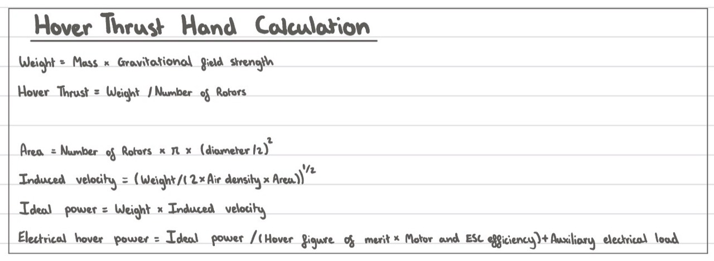
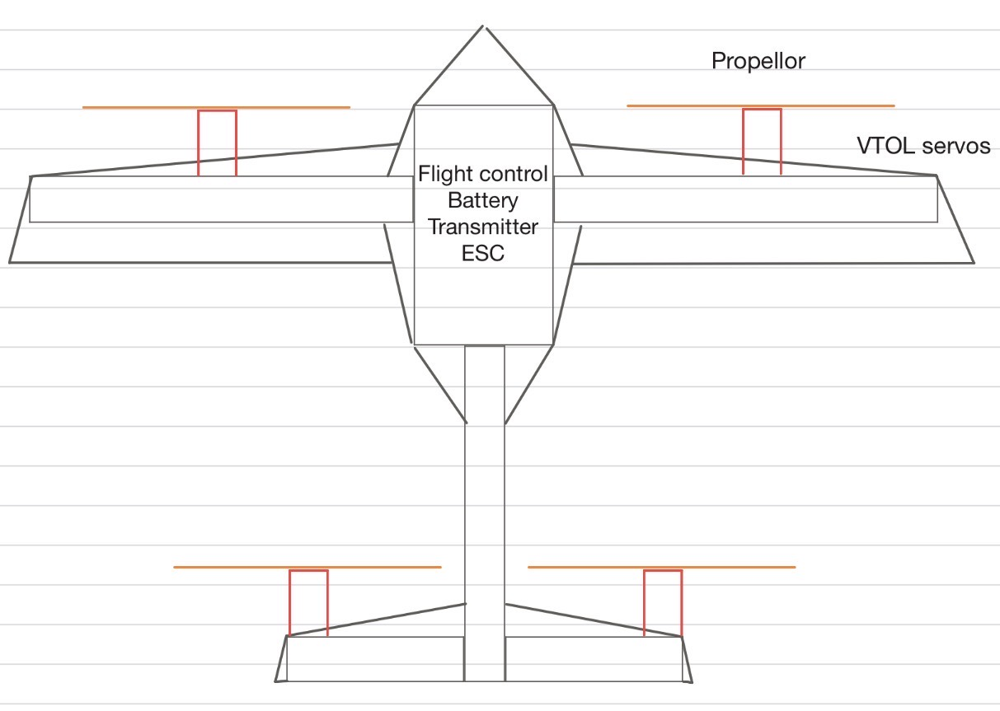

# Personal calculations and concept sketch

The project owner (`HPACKZ112`) supplied these two images on **2026-10-11** and
identified them as their own hand calculation and rough sketch. That is the
submission date; the original creation dates and preferred public name have not
been supplied. Both images are preserved unchanged. The typed review, numerical
examples and additional software checks below were prepared with AI assistance.

These establish a personal equation sheet and an initial layout concept. They
do not establish independently calculated numerical results, dimensioned CAD,
selected parts, structural adequacy, measured power or a built aircraft.

## 1. Hover equation sheet



Source: [Photo 2, unchanged original](evidence/hover-hand-calculation.jpg).

### Transcription and review

Here `T_each` is thrust per rotor and `A_total` is the sum of all rotor disc areas.
`P_ideal` and `P_elec` below are totals for the aircraft, not per-rotor powers.

```text
W = m * g
T_each = W / N
A_total = N * pi * (d / 2)^2
v_i = sqrt(W / (2 * rho * A_total))
P_ideal = W * v_i
P_elec = P_ideal / (FM * eta_motor_ESC) + P_aux
```

| Quantity | Meaning | SI unit |
| --- | --- | --- |
| m, g | All-up mass; gravitational acceleration | kg; m/s^2 |
| W, T_each | Aircraft weight; thrust per rotor | N |
| N, d | Rotor count; rotor diameter | Dimensionless; m |
| A_total, rho | Total disc area; air density | m^2; kg/m^3 |
| v_i | Induced speed at the discs | m/s |
| FM, eta_motor_ESC | Figure of merit; combined motor/ESC efficiency | Dimensionless |
| P_ideal, P_elec, P_aux | Ideal induced, electrical and auxiliary powers | W |

**Finding:** the equations are consistent with the current preliminary model.
The hover inflow and ideal power relations follow
[NASA Ames, Johnson, pp. 2-3](https://rotorcraft.arc.nasa.gov/Publications/files/Johnson_AHS-SF2004.pdf).
This requires steady, out-of-ground-effect hover, vertical thrust, equal loading
of identical non-overlapping discs, and negligible airframe download/wake interaction.
Efficiencies are assumed; auxiliary power is added once for the whole aircraft.

Two useful unit checks are `W/(rho*A)` in m^2/s^2 and `W*v_i` in N*m/s = watts.
Weight is a force in newtons, not a mass in kilograms. Write the square-root
brackets and the product `FM * eta_motor_ESC` explicitly when substituting numbers.

### Numerical examples, not handwritten results

The photo contains equations but no numerical substitutions. These examples are
AI-assisted calculations of the existing assumed cases at repository commit
`e049964c89c261fc39e96d97f4468c9393592db1`, not results claimed from the photo.

Inputs: `g=9.81 m/s^2`, `N=4`, `d=0.305 m`, `rho=1.225 kg/m^3`, `FM=0.65`,
`eta_motor_ESC=0.85`, `P_aux=10 W`. Rotor diameter and efficiencies remain
assumptions, not component selections. Source: [candidate inputs](../data/sar_design.json).

| Step | 3 kg assumed candidate | 5 kg mass-ceiling example |
| --- | ---: | ---: |
| Weight W | 29.43 N | 49.05 N |
| Equal-load thrust per rotor | 7.3575 N | 12.2625 N |
| Total disc area | 0.292247 m^2 | 0.292247 m^2 |
| Induced speed | 6.4112 m/s | 8.2768 m/s |
| Ideal induced power | 188.68 W | 405.98 W |
| Estimated total electrical hover power | 351.50 W | 744.80 W |

The 5 kg case is a stress case, not a preferred design mass. Ideal induced power
is not electrical input. These are hover estimates, not evidence of 30-minute
endurance or that a propulsion unit can deliver the required thrust.

Reproduce the current candidate using the README's sizing command. The
[equation tests](../tests/test_calculations.py) also check that equal-load
per-rotor ideal powers sum to the combined-disc result and check the two numerical
examples above. This verifies implementation consistency, not the aircraft model.

## 2. Rough four-rotor concept



Source: [Photo 1, unchanged original](evidence/layout-sketch.jpg).

The image appears to be a plan-view concept: a wide forward/main wing, central
fuselage/electronics region, a narrower aft surface connected by a central boom,
and two front plus two rear propeller symbols. The owner subsequently confirmed
that **the rear pair mounts on the horizontal tail** and **all four rotors change
from upward thrust in hover to forward thrust in cruise**. The front/main-wing
interpretation comes from the sketch; precise mounting positions, hinge geometry
and mechanism details are still open.

The owner labels propellers, VTOL servos, flight control, battery, transmitter
and ESC. "Transmitter" is retained as written; whether this means an onboard
receiver, telemetry unit or another device is open. An ESC label does not yet
define the four motor-control channels or electrical wiring. The symbolic blade
lines do not establish rotor discs, spacing or clearances.

**Not to scale.** No dimensions, CG, hinge axes, tilt travel, motor ratings,
servo count or material are specified. Do not infer dimensions from image pixels,
assume that rear rotors can attach to a light tailplane, or transfer the sketch's
unquantified geometry into the simulation as validated hardware.

### Why the sketch changes the next calculation

For two symmetric front and two symmetric rear rotors, define positive distances
`a_front` and `a_rear` from the CG to the front and rear thrust lines. In vertical
hover, ignoring other moments and download:

```text
F_front + F_rear = W
F_front * a_front = F_rear * a_rear
F_front = W * a_rear / (a_front + a_rear)
F_rear = W * a_front / (a_front + a_rear)
T_each_front = F_front / 2
T_each_rear = F_rear / 2
```

The CG must lie between those thrust lines for this positive-thrust balance.
Equal front/rear moment arms give `W/4` per rotor; visual left/right symmetry alone
does not. A new CG or unequal front/rear distances require new rotor loads and
power, even at the same total mass. For unequal loads, use each disc separately:
`P_ideal_total = sum(T_i * sqrt(T_i/(2*rho*A_i)))` before accounting for losses.

This sketch is not a free-body diagram or a stability analysis. An aft rotor
mount needs a defined load path through its support and boom, including bending,
twist and tilt loads. Individual rotor locations/limits are not represented by
the current aggregate-force simulator.

## Next personal revision

The [requested layout comparison](layout-comparison.md) now supplies AI-assisted
trial dimensions, sweep diagrams and mass/CG examples. These are not dimensions
extracted from this image or a completed personal CAD/load design.

1. Substitute the 3 kg values by hand with units, then compare with the table;
   retain the workings and explain any discrepancy. Repeat at 5 kg if useful.
2. Add an origin, axes, rotor centres, wing span/chord,
   front/rear spacing and intended battery/payload locations to the sketch.
   Provisional dimensions are acceptable when labelled as assumptions.
3. Add a side view showing hinge axes, hover/cruise thrust direction and blade
   envelopes. Check structure/ground clearance through the full tilt movement.
4. Make a free-body diagram for one tilt unit: thrust, weight, hinge and offsets.
   Calculate moments before choosing a servo; no load rating follows from the sketch.

Preferred name, mission observation duty cycle and CAD/printer details remain
open. See [contributions](contributions.md), [design gates](design-gates.md) and
[CAD guidance](../hardware/cad/README.md). No new physical dimensions or performance
inputs have been selected from these images.
