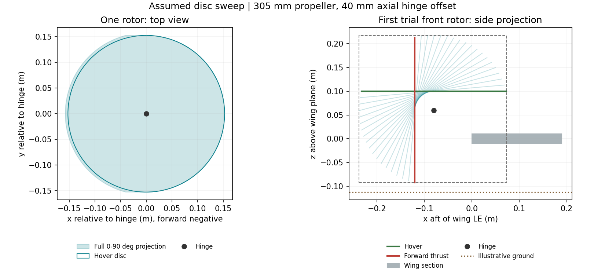
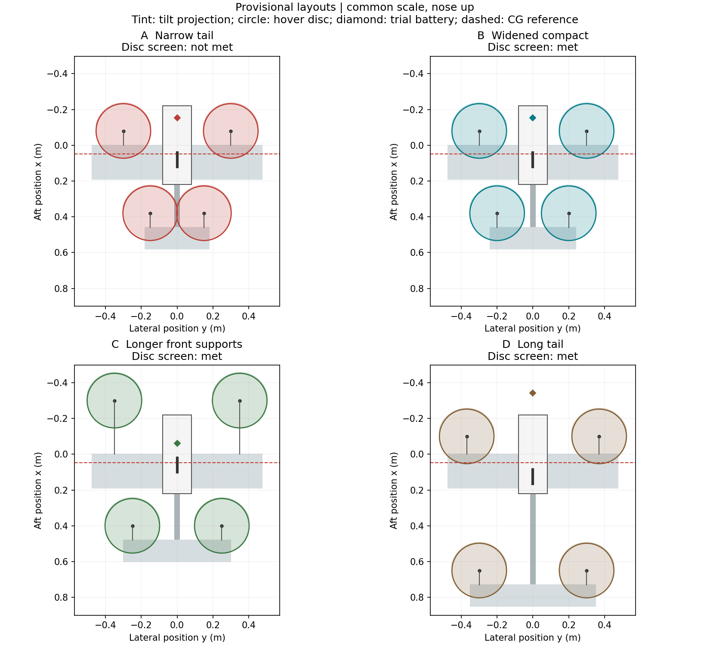
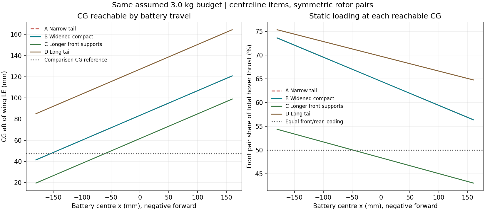

# Provisional rotor-layout comparison

AI-assisted geometric and static-balance screen, not an aircraft design approval.
All four rotors tilt forward; rear rotors attach to the horizontal tail.
Dimensions are explicit trial choices, not measurements of the owner's sketch.
All cases retain the existing assumed 3.0 kg mass budget; longer/wider structure
does not get a mass penalty here. Actual structure sizing can change the ranking.

[Methods, assumptions and interpretation](../../docs/layout-comparison.md).

## Space required per rotor

Assumed diameter 305 mm; hub 40 mm
along the thrust axis from a lateral hinge. Tilt range studied: 0 to 90 degrees.
Aerodynamic disc area: **0.07306 m^2** per rotor;
continuous top-view swept projection: **0.07530 m^2**.
The latter is packaging area, not extra lifting-disc area.
Relative to a hinge, forward extent is 157.7 mm;
aft extent 152.5 mm; lateral half-width 152.5 mm;
vertical range -152.5 to 157.7 mm.
The assumed 20 mm planning gap is not a validated safety minimum.
Same-row hubs need at least **325 mm** lateral spacing in this screen.
With hinges 60 mm above the wing plane, keeping disc tips
20 mm above flat ground through full tilt needs the wing plane at least
112.5 mm above ground.
Blade thickness/flex, motor bodies, servo/linkage, attitude and gear deflection are omitted.

## Comparison at a common CG reference

Reference x = **47.4 mm aft of the main-wing leading edge**
(25% of the assumed reference chord). It is only a comparison datum,
not an established cruise trim point, stable CG range or flight limit.
Battery figures are centre positions with x positive aft. Negative is forward.

| Trial | Row separation (mm) | Rear hub spacing (mm) | Rear disc gap (mm) | Disc-envelope screen | Battery x (mm) | Within assumed travel? | Front/rear thrust (%) | Hover estimate (W) |
| --- | ---: | ---: | ---: | --- | ---: | --- | ---: | ---: |
| A Narrow tail | 460 | 300 | -5 | Not met | -154.4 | Yes | 72.3/27.7 | 377.3 |
| B Widened compact | 460 | 400 | 95 | Met | -154.4 | Yes | 72.3/27.7 | 377.3 |
| C Longer front supports | 700 | 500 | 195 | Met | -60.6 | Yes | 50.4/49.6 | 351.5 |
| D Long tail | 750 | 600 | 295 | Met | -341.3 | No | 80.3/19.7 | 399.9 |

Power is diagnostic at the reference CG even where a layout fails clearance or
the required battery centre lies outside its travel. Such a row is not feasible.
Estimates omit download/interactions and keep efficiencies fixed. No mission
energy or transition simulation has been updated from these trial geometries.

## Weight distribution

Assumed battery-centre travel: -180 to
160 mm. Pack dimensions and mounting are unselected.
The existing airframe allowance is split 2/3 main structure and 1/3 tail/boom,
not structural predictions. Motor, propeller and tilt allowances
are split equally between rows. Other assumed stations are saved in the input file.

| Trial | CG reachable by battery travel (mm aft of LE) | Equal-load hover CG (mm) | Front thrust each (N) | Rear thrust each (N) | Extra hover power vs equal loading (W) |
| --- | ---: | ---: | ---: | ---: | ---: |
| A | 41.5 to 120.8 | 150.0 | 10.64 | 4.08 | 25.8 |
| B | 41.5 to 120.8 | 150.0 | 10.64 | 4.08 | 25.8 |
| C | 19.6 to 98.9 | 50.0 | 7.41 | 7.30 | 0.0 |
| D | 85.1 to 164.4 | 275.0 | 11.82 | 2.89 | 48.4 |

## Rotor-thrust-only load indicators

These are moments, not stresses, servo ratings or complete load cases.
Front support is referenced to main-wing LE; tail half to centreline;
boom to main-wing trailing edge. Own weights, aero, torque and dynamics are omitted.

| Trial | Front support each (N*m) | Tail half each (N*m) | Boom from rear pair (N*m) |
| --- | ---: | ---: | ---: |
| A | 0.85 | 0.61 | 1.55 |
| B | 0.85 | 0.82 | 1.55 |
| C | 2.22 | 1.83 | 3.07 |
| D | 1.18 | 0.87 | 2.66 |

## Next mechanical study

The initial B/C shortlist and trade-offs are explained in the methods document.
Re-evaluate that interpretation after changing trial dimensions or mass stations;
the generated table does not automatically select a build configuration.
Do not move CG aft just to make hover thrust equal; assess wing/tail trim and
stability separately. Keep heavy items near the centreline; lateral imbalance,
vertical CG/inertia and moving component CG through tilt remain unmodelled.

## Evidence and reproduction

[Inputs](inputs.json), [comparison CSV](comparison.csv), [clearance CSV](clearances.csv),
[trial mass positions](mass_positions.csv), [battery sweep](battery_sweep.csv).
Mass positions include the algebraically required battery even if outside travel.
Run `python -m analysis.run_layout_study`; add `--no-plots` for numerical outputs only.
Verification checks the equations and reproducibility, not physical adequacy.
